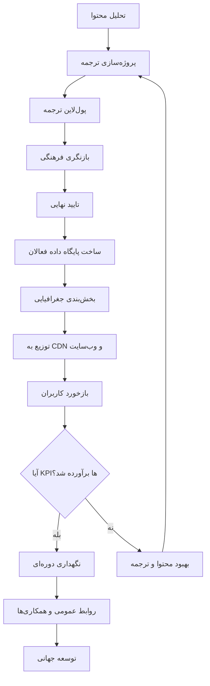

# الگوریتم و فلوچارت جهانی‌سازی نهضت تربیتی حضرت سیدالشهدا (ع)

## هدف
- گسترش پیام و محتوای آموزشی نهضت به زبان‌ها و فرهنگ‌های مختلف جهان
- شناسایی و فعال‌سازی افراد کلیدی بین‌المللی
- ایجاد زیرساخت دیجیتال برای ترجمه، توزیع و ارزیابی اثرگذاری

## مراحل الگوریتم (به‌صورت بلوک‌های عملیاتی)

1. **تحلیل محتوا اولیه**
   - جمع‌آوری اسناد، ویدیوها و دوره‌های موجود در پلتفرم نهضت.
   - استخراج کلیدواژه‌ها و موضوعات اصلی با استفاده از پردازش زبان طبیعی (NLP).
2. **پروژه‌سازی ترجمه**
   - تعریف **پول‌لاین ترجمه** شامل چهار سطح:
     - *سطح 1*: ترجمهٔ ماشین (Google, DeepL) برای پیش‌نویس اولیه.
     - *سطح 2*: بازبینی توسط مترجمین متخصص (زبان‌های هدف: انگلیسی، عربی، ترکی، فارسی, اردو, فرانسه, اسپانیایی).
     - *سطح 3*: بازنگری محتوای فرهنگی (اخلاص به ارزش‌های اسلامی/آموزشی). 
     - *سطح 4*: اعتبارسنجی نهایی توسط کمیتهٔ علمی نهضت.
3. **ساخت پایگاه دادهٔ مترجمان و فعالان**
   - استخراج اطلاعات تماس و توانمندی‌های افراد فعال از شبکه‌های اجتماعی، انجمن‌های علمی‑دین، و پایگاه دادهٔ داخلی.
   - استفاده از **مدل رتبه‌بندی** (امتیاز بر پایه تجربه، شهرت، زبان، حوزه تخصص) برای انتخاب 10‑20 نفر برگزیده.
4. **بخش‌بندی جغرافیایی**
   - تقسیم جهان به مناطقی (شرق میانه، خاورمیانه، جنوب‑شرق آسیا، اروپا، آمریکای شمالی/جنوبی).
   - تخصیص نمایندهٔ منطقه‌ای برای هماهنگی با تیم ترجمه.
5. **توزیع محتوا**
   - بارگذاری محتواهای ترجمه‌شده به **CDN بین‌المللی** (Azure, Cloudflare).
   - ایجاد نسخهٔ وب‌سایت چندزبانه با مسیرهای `/fa`, `/en`, `/ar`, `/tr`, …
   - یکپارچه‌سازی با اپلیکیشن موبایل (Capacitor) برای دسترسی آفلاین.
6. **بازخورد و ارزیابی**
   - جمع‌آوری بازخورد کاربران با فرم‌های Google‑Forms / Survey‑Monkey به چند زبان.
   - محاسبهٔ KPIها: تعداد دانلود، زمان صرف شده، نرخ تکمیل دوره، رضایت.
   - به‌روزرسانی دوره‌ای محتوا بر مبنای بازخورد.
7. **روابط عمومی و همکاری بین‌المللی**
   - برگزاری وبینارهای مشترک با مؤسسات آموزشی خارجی.
   •  تماس با سفارت‌ها، مراکز فرهنگی، و سازمان‌های NGO.
   - انتشار مقالات پژوهشی در مجلات بین‌المللی.

## فلوچارت (Mermaid)

## شناسایی افراد فعال بین‌المللی
- **منابع داده**: LinkedIn، ResearchGate، Google Scholar، انجمن‌های اسلامی، وب‌سایت‌های مدرسه‌های اسلامی.
- **فیلترها**:
  - حداقل 3 سال تجربه در آموزش اسلامی یا پژوهش قرآن.
  - تسلط به حداقل یک زبان هدف.
  - مشارکت فعال در پروژه‌های آموزشی آنلاین.
- **نتیجه**: فایل `international_activists.xlsx` شامل ستون‌های نام، ایمیل، زبان‌ها، حوزه تخصص، لینک پروفایل.

## معرفی نهضت (محتوای پیشنهادی)
> نهضت تربیتی حضرت سیدالشهدا (ع) یک بستر دیجیتال است که با هدف **تقویت هویت اسلامی، ترویج دانش قرآن و تقوا** به دانش‌آموزان و اساتید در سراسر جهان بوجود آمده است. این نهضت با بهره‌گیری از فناوری‌های نوین (ASP.NET Core, Angular, Capacitor) امکان دسترسی همیشگی به دوره‌های تخصصی، آزمون‌های خودارزیابی و محتوای علمی‑دینی را فراهم می‌کند.

---
*این مستند به‌عنوان راهنمای اجرایی برای تیم‌های فنی و روابط‌عمومی جهت راه‌اندازی و گسترش جهانی نهضت تدوین شده است.*
